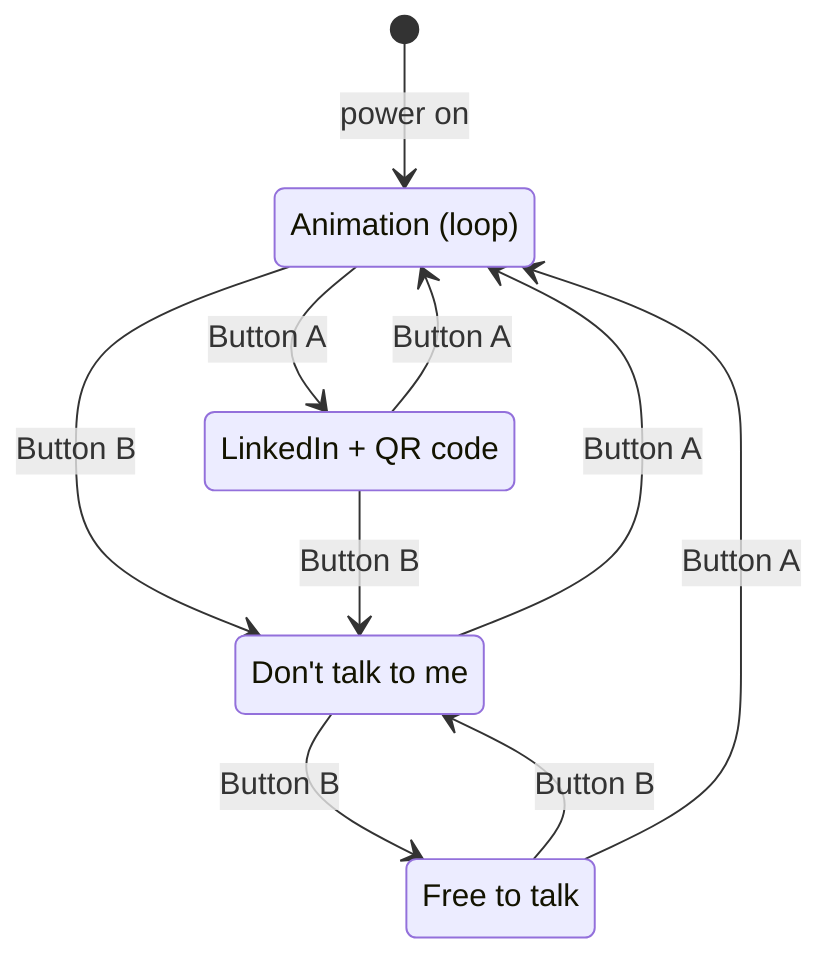

# Hair Clip with a Screen

A wearable hair clip with a tiny display. It shows cute animations, my LinkedIn with a QR code, and a status screen ("Don't talk to me" / "Free to talk"). The clip gets a 3D-printed case and is decorated with pearls and little flowers.

I'm building this to learn embedded programming from scratch: I write the code myself in CircuitPython, and I document every step here.

> **Status:** work in progress. The display is running, the screens are being built step by step.

## Demo

The LinkedIn screen: scrolling text on a pink background and a QR code that links to my LinkedIn profile.

https://github.com/user-attachments/assets/a8d31f38-1431-45d5-bde1-ea1b3ae140aa

## Hardware

| Part | Notes |
|---|---|
| [LILYGO T-Display-S3](https://github.com/Xinyuan-LilyGO/T-Display-S3) | ESP32-S3 with a 1.9" ST7789 LCD (320 × 170 px, 8-bit parallel bus), two buttons, built-in LiPo charging over USB-C |
| LiPo battery, 3.7 V | Planned: small and light enough for a hair clip (around 600 mAh, max. ~6 mm thick). The board needs a JST-GH 1.25 mm connector. |
| 3D-printed case | Planned: replaces an acrylic back plate, holds the clip, the board and the battery |
| Metal clip blank, pearls, flowers | Decoration on the front rim of the case |

Full parts list with status and battery notes: [docs/parts.md](docs/parts.md)

## How the clip behaves

The clip is a small **state machine**: it is always on exactly one screen, and each button press moves it to another one. The animation is the "home" screen.

| Current screen | Button A | Button B |
|---|---|---|
| Animation (start) | LinkedIn | Don't talk to me |
| LinkedIn + QR code | Animation | Don't talk to me |
| Don't talk to me | Animation | Free to talk |
| Free to talk | Animation | Don't talk to me |

## Roadmap

- [x] Flash CircuitPython onto the board, first output on the display
- [x] Draw on the display with `displayio` (Bitmap, Palette, TileGrid, Group): pink full-screen background
- [x] **Stage 1:** scrolling text on a coloured background ("My Linkedin: selinameusel")
- [x] **Stage 2:** QR code next to the text (scannable, generated on the board with `adafruit_miniqr`)
- [ ] **Stage 3:** read the two buttons (with debouncing)
- [ ] **Stage 4:** switch between screens (state machine)
- [ ] **Stage 5:** toggle "Don't talk to me" / "Free to talk"
- [ ] **Stage 6:** looping animation (GIF or sprite sheet, non-blocking timing)
- [ ] **Stage 7:** battery mode (GPIO15 for the display, power saving, battery level)
- [ ] Design and print the case, assemble and decorate the clip

What happened at each stage (and what broke): [docs/devlog.md](docs/devlog.md)

## Running it

1. Install CircuitPython for the T-Display-S3 with the web installer on [circuitpython.org](https://circuitpython.org/board/lilygo_tdisplay_s3/). If the board isn't found: hold **BOOT**, press **RST**, release **BOOT**.
2. The board shows up as a USB drive called **CIRCUITPY**.
3. Copy `code.py` from this repo onto CIRCUITPY. The board restarts and runs it right away. The file on the board must be called `code.py`.
4. Libraries (from the [CircuitPython bundle](https://circuitpython.org/libraries), version 9.x) go into the `lib` folder on CIRCUITPY. The code needs `adafruit_display_text` and `adafruit_miniqr`.

I write the code in VS Code (with `pip install circuitpython-stubs` for autocomplete) and read error messages in the [Thonny](https://thonny.org) shell.

## What I'm learning

- How a microcontroller runs `code.py` (auto-reload) and the difference between the REPL and a saved program
- How `displayio` draws: the bitmap stores colour numbers, the palette turns them into real colours, the TileGrid places them, and Groups stack them like layers
- The display's coordinate system: (0, 0) is the top left corner, y grows downwards
- Reading Python error messages (`SyntaxError`, `NameError`, `AttributeError`, `TypeError`)
- Planning behaviour as a state machine before writing the code

## Author

Selina Meusel, Software Engineering student at CODE University Berlin
[selinameusel.com](https://selinameusel.com) · [LinkedIn](https://www.linkedin.com/in/selinameusel)
